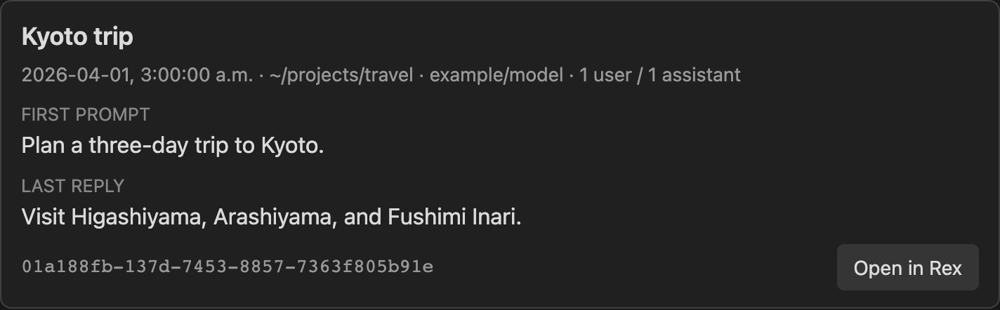

# obsidian-pi-session

Start and view Pi sessions in Obsidian. Desktop only.



## Install

1. Install Pi and Rex.
2. Copy `main.js`, `manifest.json`, and `styles.css` to `<vault>/.obsidian/plugins/pi-session/`.
3. Enable **Pi Session** in Obsidian community plugins.

The plugin reads sessions from `~/.pi/agent/sessions/`.

## Start a session

1. Select text in a note.
2. Run **Pi Session: Start Pi session from selection** from the command palette.

Rex uses or creates the `vault` session. Pi uses `$HOME` as its `cwd`. After Pi saves the prompt, the plugin replaces the text with a `pi-session` block.

If the note changes or Pi saves no prompt within 60 seconds, the plugin keeps the text. A notice gives the session ID. Pi can treat prompts that start with `/` as commands. The plugin adds a space before prompts that start with `@`.

## Open a session

Click **Open in Rex** to focus or resume a session. To add a card yourself, use a session ID:

````markdown
```pi-session
01a188fb-137d-7453-8857-7363f805b91e
```
````

Do not open a Pi session in two processes. The plugin cannot detect sessions outside its Rex tabs. Cards do not update automatically. Run **Pi Session: Refresh Pi session cards** to update them.

## Settings

Use **Settings → Community plugins → Pi Session** to choose the button target and Pi executable path.

Set **Card layout** to **Compact** to show only the title, start time, message count, session ID, and button.

Custom command arguments must be a JSON array of strings. Use `{sessionFile}`, `{sessionId}`, and `{cwd}` as placeholders. The plugin runs custom commands without a shell.

## Test

Run `node --test test.js`.
